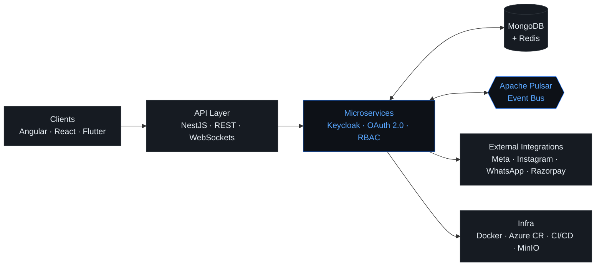

<!-- ═══════════════════════════ HERO ═══════════════════════════ -->

  

<h1 align="center">Hi 👋, I'm Sunny Kumar</h1>
<h3 align="center">Backend / Full-Stack Developer</h3>

  <b>Building scalable SaaS platforms, APIs, integrations &amp; distributed systems.</b>

  <code>NestJS</code> · <code>Node.js</code> · <code>TypeScript</code> · <code>Microservices</code>
    
  📍 Patna, India

  
  
  

 

I'm a backend-focused full-stack engineer with **4+ years** of experience building **multi-tenant SaaS platforms** on NestJS, Node.js and TypeScript. My day-to-day work covers tenant isolation, RBAC with Keycloak/OAuth 2.0, Meta & WhatsApp integrations, subscription billing and event-driven microservices on MongoDB, Redis and Apache Pulsar, shipped with Docker and CI/CD.

I'm most at home with the hard parts: OAuth/token edge cases, flaky third-party APIs and production issues that need systematic root-cause analysis.

<!-- ═══════════════════════════ SNAPSHOT ═══════════════════════════ -->
 

<table align="center">
  <tr>
    <td align="center" width="170"><h2>4+ Years</h2>EXPERIENCE</td>
    <td align="center" width="170"><h2>Backend</h2>PRIMARY FOCUS</td>
    <td align="center" width="170"><h2>SaaS</h2>PRODUCTION SYSTEMS</td>
    <td align="center" width="170"><h2>500+</h2>DSA PROBLEMS</td>
  </tr>
</table>

<!-- ═══════════════════════════ WHAT I BUILD ═══════════════════════════ -->
 

## What I Build

<table>
  <tr>
    <td width="33%" valign="top">
      <h4>🏢 Scalable SaaS</h4>
      Multi-tenant platforms with tenant isolation, RBAC and complex business workflows.
    </td>
    <td width="33%" valign="top">
      <h4>⚙️ Backend Systems</h4>
      NestJS / Node.js APIs, microservices and distributed services.
    </td>
    <td width="33%" valign="top">
      <h4>🔌 API Integrations</h4>
      Meta, Instagram, WhatsApp, Google and payment integrations.
    </td>
  </tr>
  <tr>
    <td width="33%" valign="top">
      <h4>📡 Event-Driven Systems</h4>
      Apache Pulsar, WebSockets and Redis-based architectures.
    </td>
    <td width="33%" valign="top">
      <h4>💳 Billing Systems</h4>
      Subscriptions, AI credit metering, Razorpay payments and invoicing.
    </td>
    <td width="33%" valign="top">
      <h4>🏭 Enterprise Applications</h4>
      RFID and warehouse applications used by enterprise clients.
    </td>
  </tr>
</table>

<!-- ═══════════════════════════ STACK ═══════════════════════════ -->
 

## Engineering Stack

<table>
  <tr>
    <td width="150"><b>Backend</b></td>
    <td></td>
  </tr>
  <tr>
    <td><b>Architecture</b></td>
    <td>
      
      
      
      
      
    </td>
  </tr>
  <tr>
    <td><b>Integrations &amp; Auth</b></td>
    <td>
      
      
      
      
      
      
      
      
    </td>
  </tr>
  <tr>
    <td><b>Cloud &amp; DevOps</b></td>
    <td>
      
      &nbsp;
      
      
      
      
    </td>
  </tr>
  <tr>
    <td><b>Frontend</b></td>
    <td></td>
  </tr>
  <tr>
    <td><b>Mobile &amp; Other</b></td>
    <td></td>
  </tr>
</table>

<!-- ═══════════════════════════ ARCHITECTURE ═══════════════════════════ -->
 

## Architecture

<i>Technologies &amp; architecture I work with. This is a composite view, not one specific deployed system.</i>

<!-- ═══════════════════════════ EXPERIENCE ═══════════════════════════ -->
 

## Experience

<table>
  <tr>
    <td width="140" valign="top"><code>2024 — Present</code></td>
    <td>
      <b>Backend / Full-Stack Developer</b> · Kanlas Technologies 
      Patna, India · Multi-tenant SaaS on NestJS, MongoDB &amp; event-driven microservices
    </td>
  </tr>
</table>

<b>Engineering highlights</b>

 

- **Multi-tenant core:** built and scaled the SaaS backend (NestJS, TypeScript, MongoDB) with tenant isolation and agency → business → user hierarchies.
- **Meta Graph API:** OAuth token flows, Facebook Page linking, permission scopes, Instagram Business connectivity and social analytics aggregation.
- **WhatsApp Business:** onboarding via Embedded Signup on the Cloud API, template management and webhook-driven inbound/outbound messaging.
- **Security:** Keycloak, OAuth 2.0 and role-based access control across multi-tenant roles.
- **Billing:** subscriptions, add-on location billing, AI credit metering, Razorpay payments and automated invoicing.
- **Data design:** MongoDB schemas and cross-service data flows for scheduling, invoicing, loyalty/discounts and account management.
- **Messaging & real-time:** Apache Pulsar between microservices, Redis for caching and sessions, WebSockets for live updates.
- **Frontend:** Angular / Angular Material interfaces for scheduling, billing and loyalty workflows.
- **Delivery:** Docker, Azure Container Registry and CI/CD in an NX monorepo, with MinIO object storage.

<table>
  <tr>
    <td width="140" valign="top"><code>2022 — 2023</code></td>
    <td>
      <b>Software Developer</b> · Auditech Corp LLP 
      Gurugram, India · Enterprise RFID warehouse scanning
    </td>
  </tr>
</table>

<b>The RFID story</b>

 

Warehouse RFID readers produce bursts of tag reads that have to be handled concurrently without dropping data. I built a large-scale RFID scanning application for warehouse operations, later adopted by enterprise clients including **Tata Motors, Mahindra and Voltas**.

- Implemented **multi-threaded tag processing** across Flutter and native Java for high-volume concurrent scans.
- Built two open-source Flutter plugins for UHF RFID hardware: **RFIDC72Plugin** and **ZebraRFIDPlugin**.
- Collaborated on API design and integration.

<table>
  <tr>
    <td width="140" valign="top"><code>2022 — 2023</code></td>
    <td>
      <b>Flutter Developer — Contract</b> · Sitesurface &amp; Fello 
      New Delhi &amp; Bengaluru · 6+ cross-platform apps published to Google Play, plus UI development, REST API integration and release workflows
    </td>
  </tr>
</table>

<!-- ═══════════════════════════ CURRENT FOCUS ═══════════════════════════ -->
 

## Currently Building With

  <code>NestJS</code> <code>Node.js</code> <code>TypeScript</code> <code>Microservices</code> <code>MongoDB</code>
  <code>Redis</code> <code>Apache Pulsar</code> <code>Angular</code> <code>Docker</code> <code>CI/CD</code>

<!-- ═══════════════════════════ OPEN SOURCE + PROBLEM SOLVING ═══════════════════════════ -->
 

<table>
  <tr>
    <td width="50%" valign="top">
      <h3>Open Source</h3>
      <b>Hacktoberfest 2023 Contributor</b> · Flutter / Dart  
      <b>Flutter RFID Plugins</b> for UHF RFID hardware 
      • <a href="[RFIDC72Plugin Repository]">RFIDC72Plugin</a> 
      • <a href="[ZebraRFIDPlugin Repository]">ZebraRFIDPlugin</a>
    </td>
    <td width="50%" valign="top">
      <h3>Problem Solving</h3>
      <b>500+ DSA Problems Solved</b> 
      LeetCode and other platforms  
      
    </td>
  </tr>
</table>

<!-- ═══════════════════════════ GITHUB STATS ═══════════════════════════ -->
 

## GitHub Stats

  
  

  

<!-- ═══════════════════════════ CONTRIBUTION GRAPH ═══════════════════════════ -->

  

<!-- ═══════════════════════════ CONNECT ═══════════════════════════ -->
 

## Let's Connect

  
  
  
  

  

